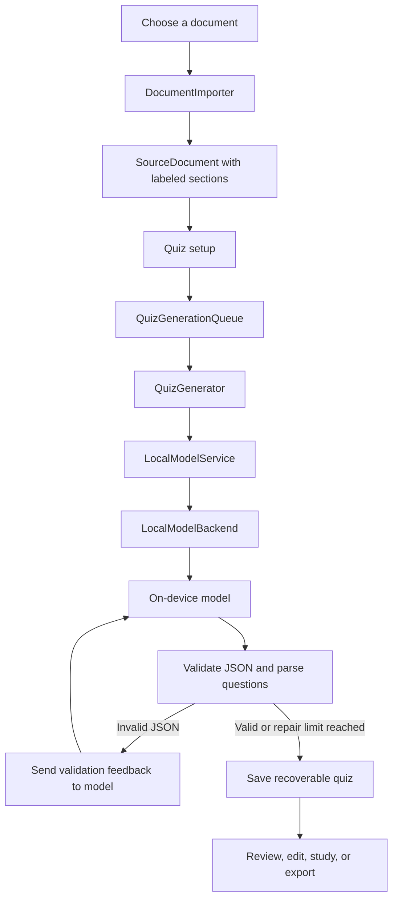

# Architecture

Revai is a Flutter app with a presentation layer in Dart, feature services in Dart, and a small Android host layer in Kotlin. The local model runtime is wrapped behind an interface so model management and generation do not depend directly on UI widgets.

## Layers

| Layer | Location | Responsibility |
| --- | --- | --- |
| Screens and widgets | `lib/main.dart`, `lib/widgets/` | Navigation and user interaction for home, setup, chat, model management, quiz review, study, and the library. |
| Domain data | `lib/models/quiz.dart` | Source sections, quiz questions, saved quizzes, folders, and quiz modes. |
| App services | `lib/services/` | Document extraction, model lifecycle and inference, generation queue, JSON parsing and repair, persistence, notifications, preferences, and PDF output. |
| Theme | `lib/theme/` | Shared colors, typography, and light/dark theme configuration. |
| Android host | `android/app/src/main/` | Flutter activity, device readiness information, and foreground notifications/service support for generation. |

The UI owns screen state and invokes services. Parsing, inference, validation, and persistence stay outside presentation widgets.

## Quiz generation flow

`DocumentImporter` converts supported files into labeled `SourceSection` values. Setup selects the sections and question mix. The queue processes one generation at a time and reports progress to the UI and Android notifications. The generator asks the selected model for structured JSON, checks the syntax and expected root shape, and makes up to three repair requests with the validation error included. Recoverable questions are kept if the response remains incomplete; the user can add questions during review.

`QuizStorage` serializes library updates and atomically replaces its JSON file. Completed quizzes are saved before the job is marked complete. Source documents themselves are not copied into saved quiz records.

## Model lifecycle and concurrency

`LocalModelService` owns initialization, downloads, installed-model discovery, model selection, inference sessions, and chat sessions. It delegates runtime-specific calls to `LocalModelBackend`; `GemmaModelBackend` adapts the `flutter_gemma` packages. `ModelPreferences` persists the selected model ID.

Quiz jobs reserve the selected model when queued. Chat and generation also hold reservations while using native sessions. Model download, selection, and removal are blocked while a reservation exists, preventing a model switch from invalidating an active or queued operation. The queue runs a single generation at a time to limit memory use and avoid overlapping native sessions.

## Persistence

- Quiz library and folders: `quiz_library.json` in the app documents directory. Legacy `saved_quizzes.json` is migrated on a library change.
- Theme preference: `theme.json` in the app documents directory.
- Selected model: `model_preferences.json` in the app documents directory.
- Pending generation jobs and chat history: in memory. Chat history is cleared when chat is left; pending jobs can be interrupted if Android terminates the app process.

## Android integration

Flutter communicates with Kotlin over method channels for device memory/storage information and generation notification/service operations. A foreground service and wake lock support a running generation while the app is backgrounded. They do not make the in-memory queue durable across process termination or device restart.
